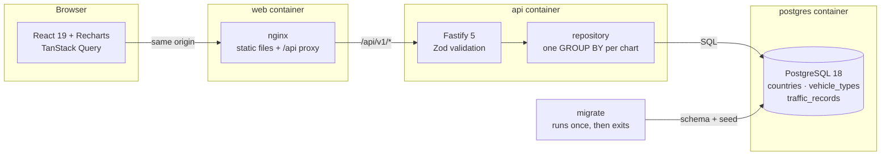

# Traffic Insights

An interactive dashboard over hourly traffic data. Node + PostgreSQL on the
back, React on the front.

Three charts, all filterable, all clickable:

- **Country-wise traffic**, horizontal bars, one per country
- **Vehicle type distribution**, a donut with real percentages in the legend
- **Traffic rhythm by local hour**, volume against mean speed on two axes

The charts are controls, not pictures. Click a bar, a slice or a legend row
and the whole dashboard filters to it.

The dataset is ~207,000 hourly observations across 16 countries and 6 vehicle
types, generated with real structure in it: commuter peaks around 08:00 and
17:30 local time, an overnight freight run, a weekend dip, and speed falling
as volume rises.

---

## Quick start

You need Docker. Nothing else.

```bash
git clone <this-repo> && cd derq
docker compose up --build
```

Then open:

| What      | Where                        |
| --------- | ---------------------------- |
| Dashboard | http://localhost:8080        |
| API docs  | http://localhost:3000/docs   |
| API       | http://localhost:3000/api/v1 |

That's it. No `psql` step, no migration to run by hand, no seed script to
remember. A `migrate` service runs first, applies the schema and seeds ~207k
rows if the database is empty, then exits. The API waits for it to finish and
the web container waits for the API to report healthy.

First build takes a couple of minutes. The seed itself takes about 4.5
seconds.

> **Port 5432 already in use?** Postgres is published on the host so you can
> point tools at it. Pick another port:
> `POSTGRES_PORT=5433 docker compose up --build`.

### Stopping

```bash
docker compose down       # stop, keep the data
docker compose down -v    # stop and delete the data
```

If you edit a migration that has already run, the next start will refuse
with "was modified after it was applied". That's on purpose: the database
no longer matches the file you're reading. During development,
`docker compose down -v` and start again.

---

## Running it locally without Docker

Handy when you're changing code and want hot reload.

```bash
nvm use                                  # Node 24, from .nvmrc
npm install                              # installs both workspaces

docker compose up -d postgres            # just the database
npm run db:migrate
npm run db:seed

npm run dev                              # API on :3000, Vite on :5173
```

Open http://localhost:5173. The Vite dev server proxies `/api` to the API, so
the browser sees a single origin and there's no CORS to think about.

If you changed `POSTGRES_PORT`, update `DATABASE_URL` in `.env.dev` to match.

---

## Architecture



### The one decision everything else follows from

**Every aggregate is computed by PostgreSQL, never in Node.** Each chart is a
single `GROUP BY` that returns at most as many rows as the dimension has
members: 16 countries, 6 vehicle types, 24 hours. Nothing streams the fact
table into the application to add it up there.

That sounds obvious written down, but it's the difference between a dashboard
that scales and one that doesn't. See [docs/scalability.md](docs/scalability.md)
for the measurements.

### Data model

Two small dimension tables and one hourly fact table.

```
countries (16)              vehicle_types (6)
  iso_code, name              code, label
  region, timezone            sort_order
       \                        /
        \                      /
         traffic_records (~207k)
           country_id, vehicle_type_id
           recorded_at   (on the hour, UTC)
           vehicle_count, avg_speed_kph
           UNIQUE (country_id, vehicle_type_id, recorded_at)
```

Some choices worth explaining:

**Hourly, not daily.** The hour is where the interesting stuff lives: rush
hour peaks, quiet weekends, trucks running at night. Average a whole day and
all of it disappears. Daily grain would also give only ~17k rows, too few for
index choice to matter.

**`countries.timezone` holds an IANA zone**, not a UTC offset. That lets the
hour chart do `recorded_at AT TIME ZONE c.timezone` and get real local time
with real DST rules, so 08:00 in Berlin and 08:00 in Tokyo land in the same
bucket. Bucket by UTC instead and sixteen rush hours smear across the day into
a flat line. Technically correct, completely useless.

**The unique key is a real constraint.** One row per country, vehicle type and
hour. It makes loading repeatable via `ON CONFLICT`, and rules out the
double-counting bug that would quietly inflate every chart on the page.

**Mean speed is weighted by vehicle count.** A plain `AVG(avg_speed_kph)`
counts an hour with 3 bicycles the same as an hour with 4,000 cars. On the
test fixtures the weighted answer is 44.0 km/h and the unweighted one is 53.3,
which is the sort of gap nobody notices until someone asks why the number
looks wrong.

**Two covering indexes** lead with `recorded_at` and `INCLUDE` the measures,
so the chart queries run as index-only scans. Verified: 69k rows aggregated in
8.8 ms with `Heap Fetches: 0`.

### Layout

```
apps/
  api/                     Fastify 5 + node-postgres
    src/
      config/env.ts        config, validated at boot
      db/                  pool, migration runner, migrations, seed
      lib/errors.ts        app errors, mapped to status codes in one place
      modules/
        traffic/           aggregates + record CRUD
        reference/         dimension data for the filters
        health/            liveness and readiness
      app.ts               builds the app, no socket
      server.ts            listens, shuts down cleanly
    test/                  unit + integration, against a real Postgres

  web/                     React 19 + Vite + Recharts
    src/
      app/                 shell, providers, design tokens
      features/
        traffic-dashboard/ the whole dashboard, one vertical slice
      shared/              Button, Card, QueryState, api client, formatters
    test/

docs/scalability.md        5 -> 50 -> 500 RPS, with measurements
```

The frontend uses vertical slice architecture, enforced by
`eslint-plugin-boundaries`: features can't import from each other, `shared/`
can't import from features, and a feature is only reachable through its
`index.ts`.

---

## API

Full OpenAPI docs at **http://localhost:3000/docs**, generated from the same
Zod schemas the runtime enforces, so they can't drift from the code.

| Method | Path                              | What it does                         |
| ------ | --------------------------------- | ------------------------------------ |
| GET    | `/api/v1/traffic/summary`         | Totals for the current filter        |
| GET    | `/api/v1/traffic/by-country`      | Country-wise volume and mean speed   |
| GET    | `/api/v1/traffic/by-vehicle-type` | Vehicle split with shares            |
| GET    | `/api/v1/traffic/by-hour`         | Volume and speed by local hour       |
| GET    | `/api/v1/traffic/records`         | Paginated raw records                |
| POST   | `/api/v1/traffic/records`         | Add a record                         |
| PATCH  | `/api/v1/traffic/records/:id`     | Update one                           |
| DELETE | `/api/v1/traffic/records/:id`     | Delete one                           |
| GET    | `/api/v1/reference`               | Countries, vehicle types, data range |
| GET    | `/health/live`                    | Liveness, never touches the DB       |
| GET    | `/health/ready`                   | Readiness, checks the DB             |

Every aggregate takes the same filters:

```
?from=2026-07-01T00:00:00Z    inclusive
&to=2026-08-01T00:00:00Z      exclusive
&countries=DE,FR,US
&vehicleTypes=car,truck
```

The window is half-open on purpose. `BETWEEN` would include both ends and
double-count the boundary hour whenever two windows sit next to each other.

```bash
curl "http://localhost:3000/api/v1/traffic/by-country?countries=DE,FR" | jq
```

### Data updates

The **Observations** panel at the bottom of the dashboard is the write path.
Add a record, edit a vehicle count inline, or delete one, and every chart
above redraws from the database, because the mutation invalidates their
queries.

It's deliberately small. It's there to show the round trip, not to be an admin
console.

Since the data is hourly, `recordedAt` is rounded down to its hour. Posting
the same country, vehicle type and hour twice gives a `409` rather than a
duplicate.

### Errors

One shape, always:

```json
{ "error": { "code": "CONFLICT", "message": "...", "details": {} } }
```

`400` failed validation, `404` not found, `409` conflicts with an existing
record, `422` unknown country or vehicle type, `429` rate limited, `500`
something else. Unexpected errors are logged in full and returned as a bare
500; internal messages and stack traces never reach a caller.

---

## Tests

```bash
npm test                  # everything
npm run test:api          # 61 tests
npm run test:web          # 23 tests
```

The API tests need a Postgres. `docker compose up -d postgres` is enough; each
test file creates and drops its own throwaway database.

**The API tests run against real PostgreSQL, not a mock.** A mocked `pg` would
happily confirm that we passed a string containing `GROUP BY` and prove
nothing about whether the grouping, the weighted average, or the timezone
conversion produce the right answer. That's the only thing these queries have
to get right.

The fixtures are four rows, picked so a wrong implementation gives a clearly
different answer instead of a slightly off one. They sit in January, when
Berlin and Paris are both UTC+1, so `08:00Z` has to land in local hour 9. A
UTC implementation returns hour 8 and fails loudly.

The web tests stub `fetch` and nothing else, so the query client, the
query-string builder, the filter state and the SVG Recharts actually draws all
run for real.

---

## Load testing

```bash
docker compose -f docker-compose.yml -f docker-compose.bench.yml up -d
npm run bench
```

The override raises the rate limit. Without it you measure the limiter and not
the app, which I found out the hard way. See
[docs/scalability.md](docs/scalability.md) for the numbers and what they mean.

---

## Scripts

| Command              | What it does                           |
| -------------------- | -------------------------------------- |
| `npm run dev`        | API and web dev servers together       |
| `npm run build`      | Build both workspaces                  |
| `npm test`           | All tests                              |
| `npm run lint`       | ESLint across both                     |
| `npm run typecheck`  | `tsc` across both                      |
| `npm run format`     | Prettier                               |
| `npm run db:migrate` | Apply pending migrations               |
| `npm run db:seed`    | Seed data (`-- --reset` to wipe first) |
| `npm run bench`      | Load test the read endpoints           |

---

## Configuration

Env files are layered, and each one has a single job:

| File           | Committed | What's in it                                     |
| -------------- | --------- | ------------------------------------------------ |
| `.env`         | yes       | Non-secret defaults for the Compose network      |
| `.env.dev`     | yes       | **Only** the values that differ locally          |
| `.env.prod`    | yes       | Standalone production set for a host's env panel |
| `.env.local`   | no        | **Secrets only**, nothing else                   |
| `.env.example` | yes       | Documents every variable                         |

The live files hold `KEY=value` and nothing else. All the explanation lives in
[`.env.example`](.env.example), so there's one place to look and no duplicated
comments to fall out of sync.

The Compose stack falls back to a throwaway local password
(`derq_local_dev`) so a fresh clone works with no setup. Override
`POSTGRES_PASSWORD` and `DATABASE_URL` in `.env.local` for anything that isn't
your own machine.

---

## CI

[`.github/workflows/ci.yml`](.github/workflows/ci.yml) runs five jobs on every
push and PR:

1. **Quality**, Prettier + ESLint + TypeScript + Knip
2. **API tests**, against a real Postgres service container
3. **Web tests**, plus a production build
4. **Docker**, builds both images
5. **Smoke**, a cold `docker compose up`, then curls the dashboard and two API
   endpoints through nginx

The smoke job is the one I care about most. Setup instructions are the thing
most likely to be quietly broken, and it's the only job that would catch it.

---

## Scaling

The short version: aggregate in SQL, keep the API stateless, cache the
aggregates, then pre-aggregate the slow one.

The long version, with load-test numbers, `EXPLAIN` output, and a measured
6x speedup from a rollup I chose _not_ to ship, is in
**[docs/scalability.md](docs/scalability.md)**.
